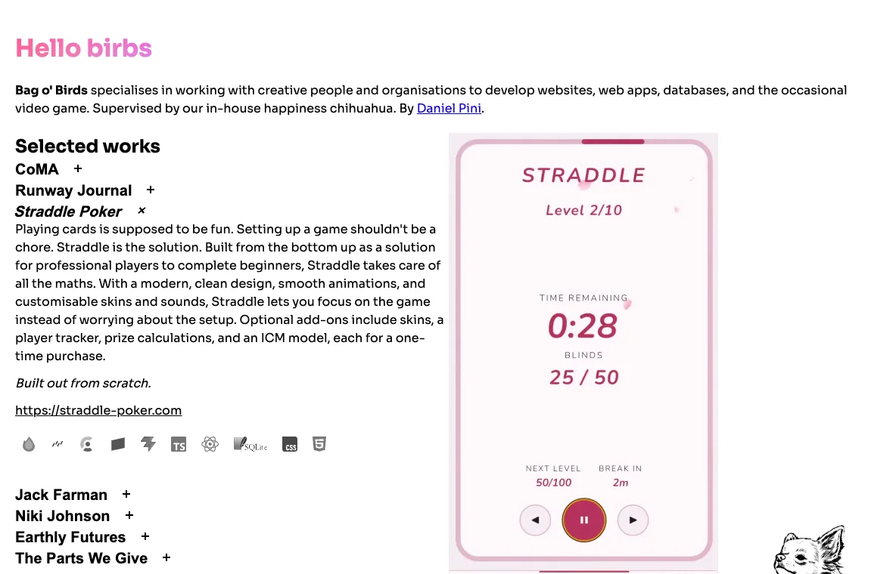

# Bag o' Birds

The site for [Bag o' Birds](https://bag-o-birds.com), a software studio led by Daniel Pini.



## Stack

React 19 with the React Compiler, TypeScript and Vite. Plain CSS, no UI or CSS framework. About 65KB of JavaScript gzipped. GitHub Actions builds it and deploys it to GitHub Pages on every push to `main`.

## Things done on purpose

- **Accessible by default.** Real buttons with `aria-expanded` and `aria-controls` for the project list, `inert` on closed panels, visible focus outlines, alt text and labels on every image and video, and one `h1` that says what the studio does.
- **Reduced motion respected.** With `prefers-reduced-motion` set, the title's colour drift stops, videos show their poster instead of autoplaying, and Bob doesn't hop.
- **Video that plays everywhere.** Each clip is H.264 MP4 first and WebM second, with a poster frame. Each one has a pause button, and its box is sized from the file's own aspect ratio, so the page doesn't jump when a clip loads.
- **Motion and layout in CSS.** React only toggles a class. The accordion animates with CSS grid (`0fr` to `1fr`), and the media column stays in view with `position: sticky`.
- **An honest date.** "Last updated" comes from the last git commit at build time, not from someone remembering to change it.
- **Bob.** Click the chihuahua.

## Run it

```sh
npm install
npm run dev
```

`npm run build` type-checks and builds to `dist/`. `npm run lint` runs ESLint.

## Licence

The code is MIT licensed (see `LICENSE`). The drawing of Bob, the project videos and screenshots, and the written copy are not covered by that licence. All rights reserved.
